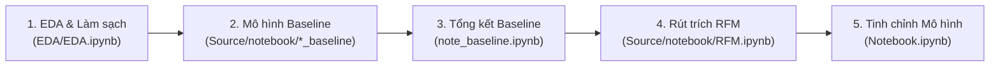

# Báo cáo giữa kỳ Máy học: Phân khúc khách hàng bằng RFM và các thuật toán phân cụm (Online Retail II)

## Thông tin học phần và nhóm thực hiện

- Trường: Đại học Sài Gòn (SGU), Khoa Công nghệ Thông tin
- Môn học: Máy học (Machine Learning)
- Lớp học phần: DCT124C1
- Giảng viên hướng dẫn: TS. Đỗ Như Tài
- Nhóm thực hiện: Nhóm 05
  1. Trương Thuận Phú (MSSV: 3124411234), nhóm trưởng
  2. Nguyễn Mạnh Thắng (MSSV: 3124411283)
  3. Nguyễn Hoàng Quân (MSSV: 3124411250)
  4. Phạm Minh Khôi (MSSV: 3124411135)

---

## 1. Giới thiệu đề tài và bộ dữ liệu

Trong bán lẻ trực tuyến, hiểu được hành vi khách hàng giúp doanh nghiệp tiết kiệm chi phí marketing và giữ chân khách tốt hơn (customer retention). Nhóm dùng học không giám sát (unsupervised learning) kết hợp mô hình RFM (Recency - Frequency - Monetary) để chia tập khách hàng lớn thành các cụm có hành vi gần nhau, rồi đề xuất cách chăm sóc riêng cho từng cụm.

- Tập dữ liệu: [Online Retail II (UCI Machine Learning Repository / Kaggle)](https://archive.ics.uci.edu/dataset/502/online+retail+ii)
- Quy mô: hơn 400.000 giao dịch thương mại điện tử thực tế, giai đoạn 2009 đến 2010.
- Ba thuộc tính RFM:
  - Recency ($R$): số ngày từ lần mua gần nhất của khách đến ngày mốc phân tích.
  - Frequency ($F$): tổng số hóa đơn khách đã thực hiện.
  - Monetary ($M$): tổng số tiền khách đã chi.

---

## 2. Cấu trúc thư mục dự án

```text
ml_group/
│
├── data/                                 # Dữ liệu phục vụ đề tài
│   ├── online_retail_cleaned.csv         # Dữ liệu giao dịch gốc ban đầu
│   ├── data_clean.csv                    # Toàn bộ dữ liệu giao dịch đã làm sạch (398,971 dòng)
│   ├── train.csv / valid.csv / test.csv  # Dữ liệu giao dịch sạch chia Train/Val/Test
│   ├── rfm_data.csv                      # Bảng chỉ số RFM toàn bộ khách hàng (4,275 KH)
│   └── rfm_train.csv / rfm_val.csv / rfm_test.csv  # Bộ chỉ số RFM chia Train/Val/Test
│
├── EDA/                                  # Khám phá Dữ liệu & Tiền xử lý Làm sạch
│   ├── EDA.ipynb                         # Notebook phân tích EDA, làm sạch và chia train/val/test data_clean
│   └── README.md                         # Tài liệu chi tiết quy trình chuẩn bị dữ liệu
│
├── figures/                              # Hình và biểu đồ gốc của đồ án
│   ├── fig00_ml_pipeline_architecture.png# Sơ đồ tổng quan pipeline
│   ├── fig01_eda_quantity_price_dist.png # Phân phối số lượng và đơn giá
│   ├── fig02_eda_boxplot_outliers.png    # Boxplot phát hiện ngoại lai
│   ├── fig03_eda_monthly_revenue.png     # Doanh thu theo tháng
│   ├── fig04_elbow_method_sse.png        # Đường cong Elbow để chọn K
│   ├── fig05_silhouette_scores_k.png     # Điểm Silhouette theo từng K
│   ├── fig06_model_comparison_metrics.png# So sánh Silhouette và Davies-Bouldin giữa các mô hình
│   ├── fig07_pca_2d_train_clusters.png   # 4 cụm trên PCA 2D
│   ├── fig08_rfm_cluster_profiles.png    # So sánh R-F-M giữa 4 phân khúc
│   └── fig09_gantt_progress_chart.png    # Tiến độ thực hiện đề tài
│
├── Source/                               # Mã nguồn chia module và thực nghiệm (OOP)
│   ├── models/                           # Các lớp mô hình phân cụm
│   │   ├── kmeans_model.py               # Tuned K-Means và hàm dò K
│   │   ├── hierarchical_model.py         # Hierarchical Clustering (Ward linkage)
│   │   └── dbscan_model.py               # DBSCAN (dựa trên mật độ)
│   ├── notebook/                         # Thực nghiệm Baseline & Feature Engineering RFM
│   │   ├── KMeans_baseline.ipynb         # Mô hình 1: K-Means Baseline (K=3, data clean)
│   │   ├── Hierarchical_baseline.ipynb   # Mô hình 2: Hierarchical Baseline (K=4, Ward, data clean)
│   │   ├── DBSCAN_baseline.ipynb         # Mô hình 3: DBSCAN Baseline (eps=0.5, min_samples=10, data clean)
│   │   ├── note_baseline.ipynb           # Báo cáo tổng kết đối chuẩn & chọn model Baseline tối ưu
│   │   ├── RFM.ipynb                     # Rút trích đặc trưng RFM, Skewness & chia tập RFM
│   │   ├── KMeans_RFM.ipynb              # Mô hình K-Means cơ sở trên bộ đặc trưng RFM (K=4)
│   │   ├── KMeans_RFM_Tuned.ipynb        # Tinh chỉnh siêu tham số K-Means RFM (Phân tích tham số & kịch bản)
│   │   ├── Hierarchical_RFM.ipynb        # Mô hình Hierarchical trên bộ đặc trưng RFM (Ward, K=4)
│   │   ├── Hierarchical_RFM_Tuned.ipynb  # Tinh chỉnh siêu tham số Hierarchical RFM (7 kịch bản, tối ưu Ward & K=4)
│   │   ├── DBSCAN_RFM.ipynb              # Mô hình DBSCAN trên bộ đặc trưng RFM (Tìm k & eps qua k-distance)
│   │   ├── DBSCAN_RFM_Tuned.ipynb        # Tinh chỉnh siêu tham số DBSCAN RFM (7 kịch bản, tối ưu eps & min_samples)
│   │   ├── note_RFM.ipynb                # Báo cáo tổng kết đối chuẩn 3 mô hình RFM & so sánh với Baseline
│   │   ├── note_RFM_Tuned.ipynb          # Báo cáo tổng kết đối chuẩn Version 3 (Tuned RFM) & kiến trúc Hybrid
│   │   └── README.md                     # Hướng dẫn chi tiết thư mục notebook
│   ├── logger.py                         # Ghi log thực nghiệm tự động
│   └── init.py                           # Định nghĩa đường dẫn và cấu hình hệ thống
│
├── note_baseline.ipynb                   # Notebook tổng kết đối chuẩn Baseline ở thư mục gốc
├── note_RFM.ipynb                        # Notebook tổng kết đối chuẩn RFM ở thư mục gốc
├── note_RFM_Tuned.ipynb                  # Notebook tổng kết đối chuẩn Version 3 (Tuned RFM) ở thư mục gốc
├── note_RFM.md                           # Báo cáo văn bản tổng kết đối chuẩn RFM & so sánh Baseline
├── note_RFM_Tuned.md                     # Báo cáo văn bản tổng kết đối chuẩn Version 3 (Tuned RFM) & kiến trúc Hybrid
├── note_baseline.md                      # Báo cáo văn bản tổng kết đối chuẩn Baseline
├── Notebook.ipynb                        # Notebook chạy toàn bộ quy trình thực nghiệm tổng thể
├── Notebook.html                         # Bản xuất HTML của Notebook
├── predict.py                            # Script dự đoán phân khúc độc lập (CLI)
├── Experiment_Log_Detailed.xlsx          # Nhật ký thực nghiệm chi tiết, có nhận xét
├── Experiment_Log_Comparison.csv         # Nhật ký thực nghiệm dạng CSV
├── requirements.txt                      # Thư viện phụ thuộc
├── Bao_Cao_Giua_Ky_Nhom05_OnlineRetailII.docx        # Báo cáo giữa kỳ (.docx)
├── Slide_Bao_Cao_Giua_Ky_Nhom05_OnlineRetailII.pptx  # Slide thuyết trình giữa kỳ (.pptx)
└── README.md
```

---

## 3. Quy trình thực nghiệm chuẩn của dự án

Quy trình thực hiện được chia làm các giai đoạn rõ ràng và tuần tự:



1. **Giai đoạn 1 - Khám phá & Làm sạch:** Chạy `EDA/EDA.ipynb` để làm sạch dữ liệu, khử đơn hủy/hoàn, tính `TotalPrice` và xuất `data/data_clean.csv`, phân chia ra 3 tập giao dịch sạch: `data/train.csv`, `data/valid.csv`, `data/test.csv`.
2. **Giai đoạn 2 - Xây dựng mốc đối chuẩn (Baseline):** Chạy 3 notebook trong `Source/notebook/`:
   - `KMeans_baseline.ipynb`: K-Means ($K=3$) trên `Quantity`, `UnitPrice`, `TotalPrice`.
   - `Hierarchical_baseline.ipynb`: Hierarchical ($K=4$, Ward) trên dữ liệu sạch cơ bản.
   - `DBSCAN_baseline.ipynb`: DBSCAN (`eps=0.5`, `min_samples=10`) trên dữ liệu sạch cơ bản.
3. **Giai đoạn 3 - Tổng kết và chọn Model Baseline tốt nhất:** Chạy `Source/notebook/note_baseline.ipynb` để so sánh định lượng và chọn **K-Means Clustering** làm mô hình cơ sở tối ưu.
4. **Giai đoạn 4 - Rút trích đặc trưng RFM chuyên sâu:** Chạy `Source/notebook/RFM.ipynb` để tính $R, F, M$ theo `CustomerID`, xử lý độ lệch Skewness, chia Train/Val/Test và fit `StandardScaler`.
5. **Giai đoạn 5 - Tinh chỉnh mô hình nâng cao & Dự đoán:** Chạy `Notebook.ipynb` để tìm $K$ tối ưu (Elbow, Silhouette), đánh giá phân khúc khách hàng và sử dụng `predict.py` để dự đoán khách hàng mới.

---

## 4. Cài đặt và chạy dự án

### Bước 1: Tạo môi trường ảo và cài thư viện
Cần Python 3.10 trở lên. Mở Terminal / PowerShell tại thư mục gốc:

```bash
python -m venv venv
venv\Scripts\activate        # Windows; trên Linux/macOS dùng: source venv/bin/activate
pip install -r requirements.txt
```

### Bước 2: Chạy các Notebook thực nghiệm
Mở trực tiếp từng notebook trên VS Code và chọn **Run All**:
- `EDA/EDA.ipynb`
- `Source/notebook/KMeans_baseline.ipynb`
- `Source/notebook/Hierarchical_baseline.ipynb`
- `Source/notebook/DBSCAN_baseline.ipynb`
- `Source/notebook/note_baseline.ipynb`
- `Source/notebook/RFM.ipynb`
- `Notebook.ipynb`

### Bước 3: Dự đoán phân khúc khách hàng bằng `predict.py`
Dự đoán một khách hàng độc lập qua CLI:
```bash
python predict.py --recency 15 --frequency 8 --monetary 2500
```
Dự đoán hàng loạt khách hàng từ file CSV:
```bash
python predict.py --file data/rfm_test.csv --output data/predictions_test.csv
```

---

## 5. Kết quả thực nghiệm

### 5.1. Bảng số liệu đối chuẩn ở mức Baseline (Dữ liệu sạch cơ bản)

| Mô hình Baseline | Cấu hình | Train Silhouette | Validation Silhouette | Test Silhouette | Calinski-Harabasz (Train) | Tốc độ | Đánh giá |
| :--- | :--- | :---: | :---: | :---: | :---: | :---: | :--- |
| **K-Means (chọn)** | **$K=3$, basic** | **0.6244** | **0.6175** | **0.6417** | **150,925.86** | **0.52s** | **Tốt nhất:** Tốc độ nhanh, ổn định tuyệt đối qua 3 tập, cụm cân đối. |
| **Hierarchical** | $K=4$, ward | 0.6258 | 0.6346 | 0.6566 | 3,130.95 | 0.34s (5K) | Cây Dendrogram trực quan nhưng nghẽn bộ nhớ $O(N^2)$, phải lấy mẫu. |
| **DBSCAN** | $eps=0.5, min=10$ | 0.6440\* | 0.6413\* | 0.6600\* | 963.99 | 0.50s (10K) | Điểm cao nhưng 98.2% điểm dồn vào cụm 0, mất ý nghĩa phân khúc. |

*\*Lưu ý: Chỉ số DBSCAN tính trên các cụm hợp lệ, tách được 1.71% điểm nhiễu ngoại lai.*

### 5.2. Bảng kết quả các mô hình tinh chỉnh trên bộ chỉ số RFM

Khi áp dụng kỹ thuật rút trích đặc trưng RFM và tinh chỉnh tham số (Hyperparameter Tuning):

| STT | Mô hình | Cấu hình | Silhouette | Davies-Bouldin | Calinski-Harabasz | Nhận xét thực tế |
| :-: | :--- | :--- | :-: | :-: | :-: | :--- |
| 1 | Baseline K-Means | $K=3$, RFM thô | 0.3298 | 1.0709 | 2,199.32 | Mốc tham chiếu RFM ban đầu |
| 2 | Hierarchical | $K=4$, ward | 0.2976 | 1.0827 | 1,808.38 | Phân cụm thứ bậc tự nhiên |
| 3 | DBSCAN | $\varepsilon=0.6$, $min=10$ | 0.5254\* | 0.4055\* | 117.32 | Chỉ số cao do 1 cụm chiếm đa số, nhạy cảm với $\epsilon$ |
| 4 | Tuned K-Means | $K=2$ | 0.4224 | 0.9119 | 2,614.55 | Silhouette cao nhất nhưng chỉ có 2 nhóm, quá thô |
| 5 | **Tuned K-Means (chọn)** | **$K=4$** | **0.3385** | **0.9960** | **2,090.80** | **Tối ưu nhất:** 4 phân khúc khách hàng rõ nét, dễ diễn giải marketing |
| 6 | Tuned DBSCAN | $\varepsilon=0.3$, $min=5$ | 0.0242 | 1.1821 | 341.22 | Vỡ vụn thành 13 cụm nhỏ và 224 điểm nhiễu |
| 7 | **Validation Set** | $K=4$, 684 KH | **0.3193** | **1.0210** | **503.80** | Rất gần với Train, độ suy giảm chỉ 5.6%, không có Overfitting |

---

## 6. Bốn phân khúc khách hàng và chiến lược kinh doanh đề xuất

| Cụm | Phân khúc | Đặc trưng RFM | Tỷ lệ | Chiến lược Marketing & Chăm sóc đề xuất |
| :-: | :--- | :--- | :---: | :--- |
| **1** | **Champions (Khách VIP)** | $R$ rất thấp (mới mua), $F$ cao nhất, $M$ lớn nhất | ~18 - 27% | Giữ chân bằng đặc quyền: Thẻ VIP, quà sinh nhật cá nhân hóa, trải nghiệm sản phẩm mới sớm. Tuyệt đối tránh giảm giá đại trà làm mất giá trị thương hiệu. |
| **3** | **Potential Loyalists (Tiềm năng)** | Mua gần đây, $F$ và $M$ ở mức khá | ~21 - 25% | Tăng tần suất mua: Gợi ý sản phẩm mua kèm (Cross-sell / Up-sell), tặng voucher cho đơn kế tiếp, mời tham gia chương trình khách hàng thân thiết. |
| **0** | **At Risk (Nguy cơ rời bỏ)** | Trước đây mua tốt nhưng $R$ cao (> 180 ngày chưa quay lại) | ~24 - 32% | Kéo khách quay lại (Win-back): Gửi email cá nhân hóa "Chúng tôi nhớ bạn" kèm mã giảm giá riêng, khảo sát lý do trước khi khách chuyển sang đối thủ. |
| **2** | **Lost / Hibernating (Rời bỏ)** | Rất lâu không mua, $F$ và $M$ rất thấp | ~20 - 25% | Tiết kiệm chi phí: Không tốn ngân sách telesale hay SMS trực tiếp, chỉ tiếp cận qua quảng cáo mạng xã hội diện rộng với chi phí tối thiểu. |

---

## 7. Sản phẩm bàn giao

1. `Bao_Cao_Giua_Ky_Nhom05_OnlineRetailII.docx`: Báo cáo chi tiết đề tài (20+ trang).
2. `Slide_Bao_Cao_Giua_Ky_Nhom05_OnlineRetailII.pptx`: Slide thuyết trình báo cáo giữa kỳ.
3. `EDA/EDA.ipynb`: Toàn bộ phân tích khám phá và làm sạch dữ liệu giao dịch.
4. `Source/notebook/`: 5 notebook thực nghiệm Baseline, đối chuẩn và rút trích RFM.
5. `Notebook.ipynb` và `Notebook.html`: Toàn bộ quy trình mô hình hóa tinh chỉnh tổng thể.
6. `Experiment_Log_Detailed.xlsx` & `Experiment_Log_Comparison.csv`: Nhật ký thực nghiệm khoa học.
7. `figures/`: Hơn 10 biểu đồ trực quan hóa độ phân giải cao.
8. `saved_models/` & `predict.py`: Mô hình K-Means tối ưu đã lưu và script dự đoán CLI.
