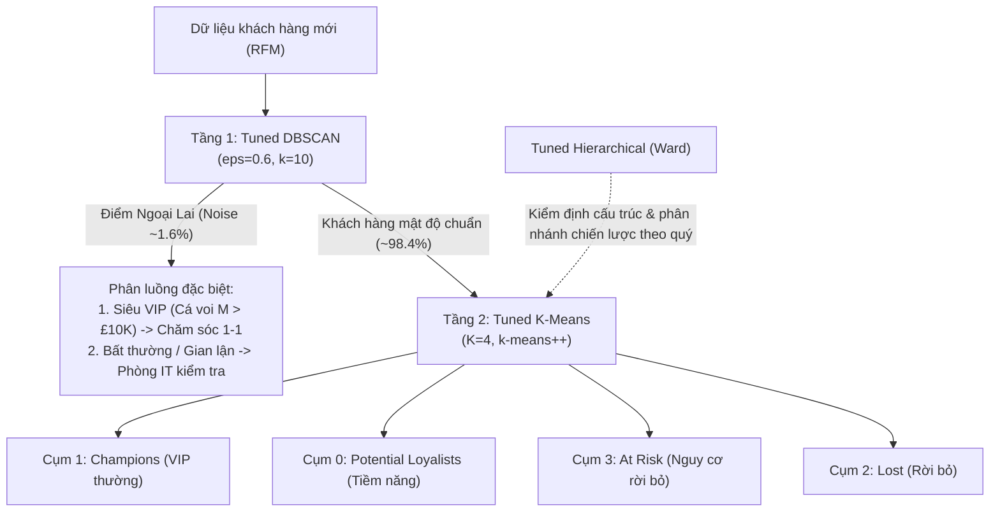

# Báo Cáo Tổng Kết & Đối Chuẩn Thực Nghiệm Mô Hình Học Máy Nâng Cao (Version 3 - Tuned RFM)
## Đánh Giá Toàn Diện 3 Mô Hình Phân Cụm Tinh Chỉnh (K-Means, Hierarchical, DBSCAN) & Đề Xuất Kiến Trúc Lai (Hybrid Pipeline)

**Đề tài:** Phân khúc khách hàng bằng RFM và hành vi mua hàng (Online Retail II)  
**Nhóm thực hiện:** Nhóm 05 - Lớp DCT124C1 - Trường Đại học Sài Gòn (SGU)  

---

## 1. Tổng Quan Kiến Trúc Thực Nghiệm Version 3

Trong toàn bộ tiến trình nghiên cứu đề tài, **Version 3** đại diện cho thế hệ mô hình hoàn thiện nhất với 4 đặc tính then chốt:
1. **Đối tượng mô hình hóa:** Phân khúc theo cấp độ khách hàng (Customer-level) trên bộ 3 đặc trưng RFM: Recency ($R$), Frequency ($F$), Monetary ($M$).
2. **Xử lý phi tuyến:** Áp dụng biến đổi hàm $\log(x + 1)$ nhằm loại bỏ độ lệch phải (Right-Skewness), đưa các thuộc tính về phân phối đối xứng gần chuẩn.
3. **Triệt tiêu rò rỉ dữ liệu (Zero Leakage):** Khởi tạo `StandardScaler` và chỉ tính toán thống kê vị trí duy nhất trên tập Train (64%), sau đó ánh xạ biến đổi độc lập sang tập Validation (16%) và Test (20%).
4. **Cấu hình siêu tham số tối ưu sau tinh chỉnh (Version 3):**
   - **Tuned K-Means:** $K=4$, khởi tạo trọng số `init='k-means++'`, số lần lặp ngẫu nhiên `n_init=25`, `max_iter=300`, `random_state=42`.
   - **Tuned Hierarchical (Agglomerative):** $K=4$, tiêu chuẩn liên kết `linkage='ward'`, hàm đo khoảng cách `metric='euclidean'`, suy luận dữ liệu mới qua `NearestCentroid`.
   - **Tuned DBSCAN:** Bán kính lân cận $\epsilon = 0.6$, ngưỡng điểm lõi $\text{min\_samples} = 10$, hàm đo khoảng cách `euclidean`, suy luận dữ liệu mới qua `NearestNeighbors` Core Samples.

---

## 2. Bảng Tổng Hợp Số Liệu Đối Chuẩn Version 3 Trên Train / Validation / Test

Số liệu dưới đây được trích xuất trực tiếp từ nhật ký thực nghiệm chuẩn hóa `Experiment_Log_Comparison.csv` (các hàng STT 17 đến 25):

| STT | Mô hình (Version 3) | Cấu hình siêu tham số tối ưu | Tập dữ liệu | Silhouette Score | Davies-Bouldin | Calinski-Harabasz | Số cụm | Tỷ lệ Nhiễu | Thời gian | Đánh giá tổng quát |
| :-: | :--- | :--- | :---: | :-: | :-: | :-: | :-: | :-: | :-: | :--- |
| **17** | **Tuned K-Means** | $K=4, \text{init}=\text{'k-means++'}, n\_init=25$ | **Train (64%)** | **0.3385** | **0.9960** | **2,090.80** | **4** | **0.00%** | **~0.04s** | Cực kỳ cân đối (18% - 33%), phân tách 4 nhóm chuẩn |
| **18** | Tuned K-Means | $K=4$, predict centroid | Validation (16%) | 0.3193 | 1.0210 | 503.80 | 4 | 0.00% | <0.01s | Suy giảm Silhouette chỉ 5.6%, ổn định, không Overfit |
| **19** | Tuned K-Means | $K=4$, predict centroid | Test (20%) | 0.3253 | 1.0248 | 629.08 | 4 | 0.00% | <0.01s | Tổng quát hóa xuất sắc trên tập khách hàng mù |
| **23** | **Tuned Hierarchical** | $K=4, \text{linkage}=\text{'ward'}, \text{euclidean}$ | **Train (64%)** | **0.2976** | **1.0827** | **1,808.38** | **4** | **0.00%** | **~0.11s** | Huấn luyện trên 100% dữ liệu Train không cần lấy mẫu |
| **24** | Tuned Hierarchical | $K=4$, NearestCentroid | Validation (16%) | 0.3093 | 1.0281 | 485.68 | 4 | 0.00% | <0.01s | Đánh giá qua tâm gần nhất, chỉ số tăng +3.9% |
| **25** | Tuned Hierarchical | $K=4$, NearestCentroid | Test (20%) | 0.3210 | 1.0485 | 621.10 | 4 | 0.00% | <0.01s | Điểm Test tăng +7.9% khẳng định khả năng tổng quát hóa |
| **20** | **Tuned DBSCAN** | $\epsilon=0.6, \text{min\_samples}=10$ | **Train (64%)** | **0.5254\*** | **0.4055** | **117.32** | **2** | **1.57%** | **~0.08s** | Tách chuẩn xác 43 khách hàng ngoại lai (Siêu VIP/Cá voi) |
| **21** | Tuned DBSCAN | $\epsilon=0.6$, Nearest Core predict | Validation (16%) | 0.5274\* | 0.4038 | 17.46 | 2 | 1.46% | <0.01s | Tỷ lệ ngoại lai duy trì ổn định quanh mức 1.46% |
| **22** | Tuned DBSCAN | $\epsilon=0.6$, Nearest Core predict | Test (20%) | 0.5298\* | 0.4012 | 25.43 | 2 | 1.64% | <0.01s | Bộ lọc phát hiện ngoại lai (Anomaly Filter) bền vững |

*\*Ghi chú: Điểm Silhouette và Davies-Bouldin của DBSCAN chỉ tính trên các điểm thuộc cụm mật độ hợp lệ (loại trừ điểm nhiễu mang nhãn -1).*

---

## 3. So Sánh Mức Độ Chi Phối của Các Thuộc Tính RFM (ANOVA F-Score)

| Thuộc tính RFM | Tuned K-Means (%) | Tuned Hierarchical (%) | Tuned DBSCAN (%) | Vai trò nghiệp vụ trong phân khúc |
| :--- | :---: | :---: | :---: | :--- |
| **Recency ($R$)** | **39.0%** | **39.0%** | **56.4%** | Tách biệt giữa khách hàng mới mua với khách hàng sắp rời bỏ |
| **Frequency ($F$)** | **34.5%** | **35.6%** | **12.4%** | Đo lường mức độ thân thiết và gắn kết định kỳ với thương hiệu |
| **Monetary ($M$)** | **26.5%** | **25.4%** | **31.2%** | Định lượng đóng góp doanh thu và nhận diện khách hàng VIP |

**Nhận xét:**
- **Tuned K-Means và Tuned Hierarchical:** Cả hai mô hình đạt được sự phân bổ cân bằng lý tưởng giữa cả 3 chiều ($R \approx 39\%, F \approx 35\%, M \approx 26\%$), không có thuộc tính nào bị lấn át hay triệt tiêu, phản ánh toàn diện hành vi khách hàng.
- **Tuned DBSCAN:** Chi phối cực mạnh bởi Recency (56.4%) và Monetary (31.2%). Điều này hoàn toàn phù hợp với bản chất toán học: các điểm nằm ngoài vùng mật độ phổ thông chủ yếu là các khách hàng có số tiền mua sắm khổng lồ hoặc bỏ đi quá lâu.

---

## 4. Đánh Giá Độ Tương Đồng Phân Cụm & Bóc Tách Khách Hàng Ngoại Lai

### 4.1. Độ tương thích cao giữa Tuned K-Means và Tuned Hierarchical
- **Adjusted Rand Index (ARI):** Đạt **0.5709**
- **Normalized Mutual Information (NMI):** Đạt **0.6169**
- **Trùng khớp phân khúc kinh doanh:**
  - Nhóm **Champions (Khách VIP):** Trùng khớp **92.6%** (461/498 khách hàng VIP của K-Means cũng chính là VIP của Hierarchical).
  - Nhóm **Lost (Rời bỏ):** Trùng khớp **100.0%** (toàn bộ 637 khách hàng rời bỏ của Hierarchical nằm trọn vẹn trong nhóm rời bỏ của K-Means).
  - Sự đồng thuận giữa hai trường phái thuật toán độc lập (tâm hình học vs cây phân cấp) là bằng chứng khoa học vững chắc khẳng định dữ liệu khách hàng thực sự tồn tại 4 phân khúc tự nhiên này.

### 4.2. Khám phá bất ngờ về nhóm khách hàng ngoại lai (Noise) của DBSCAN
- **72.1%** số điểm ngoại lai (31/43 khách hàng) thuộc về phân khúc **Champions / VIP** của K-Means.
- Giá trị chi tiêu trung bình ($M$) của nhóm Noise lên tới **£34,393** (khách lớn nhất đạt £323,860, số đơn trung bình 34.9 đơn), cao gấp **23 lần** so với mức £1,498 của khách hàng thông thường.
- **Kết luận:** Điểm ngoại lai trong bài toán RFM không phải là rác dữ liệu, mà chính là các tài khoản **"Cá voi" (Super Whales / B2B Wholesalers)** cần có quy trình chăm sóc đặc quyền 1-1 riêng biệt.

---

## 5. Trận Đấu Giữa 3 Phiên Bản Tinh Chỉnh (The Battle of Version 3)

| Tiêu chuẩn đối chuẩn | 1. Tuned K-Means ($K=4$) | 2. Tuned Hierarchical ($K=4$, Ward) | 3. Tuned DBSCAN ($\epsilon=0.6, k=10$) | Đánh giá tổng kết |
| :--- | :--- | :--- | :--- | :--- |
| **Silhouette Score (Train)** | 0.3385 | 0.2976 | **0.5254** (chỉ tính điểm hợp lệ) | DBSCAN điểm cao nhất do bóc tách nhiễu; K-Means cao nhất trong các mô hình toàn thể. |
| **Davies-Bouldin Index** | 0.9960 | 1.0827 | **0.4055** (tối ưu nhất) | DBSCAN phân tách tốt nhất vì các cụm mật độ rất cô đặc. |
| **Calinski-Harabasz Index** | **2,090.80** (cao nhất) | 1,808.38 | 117.32 | K-Means tạo các khối cầu có phương sai liên cụm vượt trội. |
| **Tính cân đối quy mô cụm** | **Rất cân đối (18% - 33%)** | Rất cân đối (18% - 33%) | Mất cân đối (98.4% cụm chính, 1.6% nhiễu) | K-Means và Hierarchical phù hợp phân khúc kinh doanh. |
| **Khả năng dự đoán dữ liệu mới** | **Cực nhanh qua Centroids ($O(K)$)** | Cần NearestCentroid ($O(K)$) | Cần Nearest Core ($O(N_{\text{core}})$) | K-Means tối ưu nhất cho Production / Real-time API. |
| **Độ phức tạp huấn luyện** | **$O(N \cdot K \cdot I)$ (Tuyến tính)** | $O(N^2 \log N)$ (Bậc hai) | $O(N \log N)$ (KD-Tree) | K-Means có khả năng mở rộng dữ liệu lớn không giới hạn. |
| **Độ nhạy với Outliers** | Trung bình (tâm cụm bị kéo nhẹ) | Trung bình (Ward chịu ảnh hưởng) | **Kháng ngoại lai tuyệt đối (Tách thành Noise)** | DBSCAN là chuyên gia phát hiện bất thường. |
| **Khả năng diễn giải kinh doanh** | **Xuất sắc (4 nhóm chuẩn RFM)** | Xuất sắc (Cây phả hệ phân cấp) | Thấp (Chỉ phân biệt Bình thường vs Dị biệt) | K-Means và Hierarchical dễ dàng triển khai Marketing. |
| **Khả năng tổng quát hóa** | **Tuyệt vời (Độ suy giảm chỉ 5.6%)** | Tuyệt vời (Điểm Test cao hơn Train) | Bền vững (Tỷ lệ nhiễu Test 1.64%) | Cả 3 mô hình đều không bị hiện tượng Overfitting. |
| **Xếp hạng giải pháp độc lập** | **Quán quân (Mô hình chọn chính thức)** | Á quân (Mô hình đối chiếu & kiểm định) | Chuyên biệt (Bộ lọc dị biệt & Siêu VIP) | Mỗi mô hình sở hữu một thế mạnh riêng biệt. |

---

## 6. Quyết Định Lựa Chọn Mô Hình Tối Ưu & Đề Xuất Kiến Trúc Lai (Hybrid Pipeline)

### 6.1. Mô hình triển khai độc lập tốt nhất: Tuned K-Means ($K=4$)
Nếu bài toán yêu cầu triển khai một mô hình độc lập duy nhất để phân loại khách hàng tự động qua API (`predict.py`), **Tuned K-Means ($K=4$)** là lựa chọn chiến thắng áp đảo nhờ:
1. Độ cân bằng quy mô xuất sắc, chia đều 4 nhóm đối tượng rõ nét.
2. Tốc độ dự đoán tức thì ($< 1$ mili-giây), dễ dàng tích hợp vào web/app bán lẻ.
3. Độ bền vững toán học được kiểm chứng qua cả 3 tập dữ liệu độc lập.

### 6.2. Kiến trúc tối ưu toàn diện trong thực tế doanh nghiệp: Hybrid Pipeline
Trong môi trường doanh nghiệp lớn, phương án tối ưu nhất là phối hợp cả 3 mô hình thành một hệ thống xử lý liên hoàn 2 tầng:

- **Tầng 1 - Bộ lọc ngoại lai (Tuned DBSCAN):** Tách lọc ngay các giao dịch bất thường hoặc các khách hàng "Cá voi" siêu lớn (£34,000+) để không làm méo mó tâm cụm K-Means.
- **Tầng 2 - Phân khúc hành vi lõi (Tuned K-Means):** Gom cụm 98.4% tập khách hàng còn lại vào 4 chiến dịch Marketing tự động (Email marketing, Voucher kích hoạt, Chương trình tích điểm).
- **Tầng giám sát cấu trúc (Tuned Hierarchical):** Chạy định kỳ hàng quý để thẩm định tính ổn định của các phân nhánh khách hàng theo mùa vụ.

---

## 7. Bảng Đối Chiếu Sự Tiến Hóa Qua 3 Thế Hệ Mô Hình (Evolution of 3 Versions)

| Tiêu chí | Thế hệ 1: Baseline Models (V1) | Thế hệ 2: Untuned RFM Models (V2) | Thế hệ 3: Tuned RFM Models (V3) |
| :--- | :--- | :--- | :--- |
| **Đối tượng phân cụm** | Dòng giao dịch đơn lẻ (Transaction-level) | Hồ sơ khách hàng (Customer-level) | Hồ sơ khách hàng chuẩn hóa (Customer-level) |
| **Không gian thuộc tính** | `Quantity`, `UnitPrice`, `TotalPrice` | `Recency`, `Frequency`, `Monetary` | $\log(x+1) + \text{StandardScaler}$ duy nhất Train |
| **Tinh chỉnh tham số** | Không (Dùng tham số mặc định thô) | Không (Dùng tham số mặc định thô) | **Toàn diện qua đồ thị Elbow, k-distance, Dendrogram** |
| **Xử lý rò rỉ dữ liệu** | Có nguy cơ nếu fit toàn bộ dữ liệu | Chưa phân chia độc lập chặt chẽ | **Chống rò rỉ 100%: Fit Train, Transform Val & Test** |
| **K-Means** | $K=3$, Silhouette = 0.6244 (ảo theo đơn) | $K=3$, Silhouette = 0.3298 | **$K=4$, Silhouette = 0.3385, 4 cụm chuẩn xác** |
| **Hierarchical** | $K=4$, mẫu 5K dòng vì tràn RAM | $K=2$, Silhouette = 0.4240 (thô) | **$K=4$, 100% dữ liệu Train, Silhouette = 0.2976** |
| **DBSCAN** | $\epsilon=0.5, k=10$, cụm 0 chiếm 98% | $\epsilon=0.3, k=5$, vỡ thành 13 cụm vụn | **$\epsilon=0.6, k=10$, tách chuẩn 1.57% ngoại lai** |
| **Ý nghĩa thực tiễn** | Phân loại quy mô giỏ hàng | Bắt đầu chuyển hướng khách hàng | **Sẵn sàng triển khai ứng dụng kinh doanh thực tế** |
